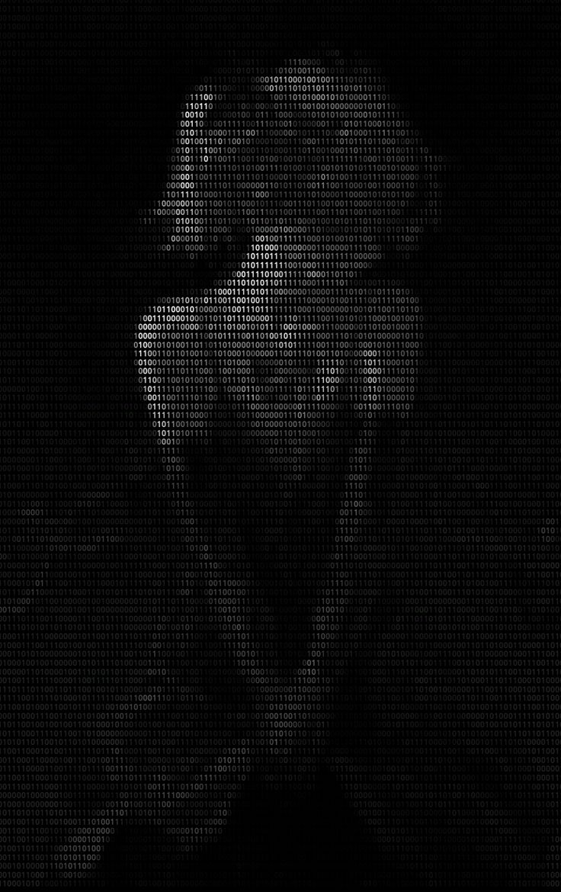

<!-- ========================================= -->
<!-- CAROLYN PEDROZA | CYBERSECURITY PROFILE    -->
<!-- ========================================= -->

<p align="center">
  
</p>


<p align="center">
  <strong>Cybersecurity Student • Future Security Analyst</strong>
</p>

<p align="center">
  
  
  
</p>

---

# 01 / WHOAMI

The quickest way to answer that:

```bash
╭─ carolyn@nau:~
╰─$ whoami

Carolyn Pedroza

Cybersecurity student at Northern Arizona University.

Focused on:
• Security Operations
• Cloud Security
• Threat Detection
• Security Engineering

Currently building experience through:
• Hands-on labs
• Capture The Flags
• Hackathons
• Technical projects
• Industry certifications
• Continuous learning

Goal:
Become a Security Analyst and contribute to teams that
protect systems, solve problems, and strengthen security.

╭─ carolyn@nau:~
╰─$
```

---

# 02 / TOOLKIT

### Programming & Databases


### Operating Systems & Cloud


### Security & Networking


---

# 03 / CURRENT_MISSION

```python
current_mission = {
    "goal": "Become a Security Analyst",

    "building": [
        "Python",
        "Linux",
        "Networking",
        "SQL",
        "AWS Fundamentals",
        "Cloud Security"
    ],

    "currently_focused_on": [
        "Security Operations",
        "Threat Detection",
        "CompTIA Security+"
    ],

    "mindset": "Learn. Apply. Improve."
}
```

---

# 04 / PROJECT_ARCHIVE

Every skill deserves proof.

The projects below document what I'm learning, how I'm applying it, and how I'm growing as a cybersecurity professional.

| PROJECT | AREA | STATUS |
|----------|----------|----------|
| Windows Event Log Analysis | Security Operations | Planned |
| Network Traffic Analysis | Network Security | Planned |
| AWS Security Labs | Cloud Security | In Progress |
| Vulnerability Assessment | Security Testing | Planned |

*Additional projects, documentation, and write-ups will be added as they are completed.*

---

# 05 / CERTIFICATIONS

I'm committed to building practical knowledge through certifications, labs, and hands-on experience.

- CompTIA Security+ *(In Progress)*
- AWS Fundamentals
- Security Operations Labs
- Network Analysis Exercises
- Independent Cybersecurity Projects

---

# 06 / GITHUB_ACTIVITY

<p align="center">


</p>

---

# 07 / BEYOND_THE_TERMINAL

<table>
<tr>

<td width="65%" valign="top">

### Beyond the Terminal

I enjoy figuring out how things work.

Whether I'm troubleshooting a lab, learning a new technology, or taking on a project that pushes me outside my comfort zone, I enjoy turning curiosity into practical skills.

Cybersecurity combines everything that excites me about technology: problem-solving, continuous learning, and the challenge of staying one step ahead in a constantly evolving field.

Right now, my focus is building a strong technical foundation. Long term, my goal is to help organizations strengthen their security and defend against real-world threats.

<i>Stay curious. Keep building.</i>

</td>

<td width="35%" align="center" valign="middle">



</td>

</tr>
</table>

---

# 08 / CONNECT

<p align="center">

<a href="https://github.com/cpedr0za">
  
</a>

<a href="https://www.linkedin.com/in/carolyn-pedroza-42b346376/">
  
</a>

</p>

<p align="center">
  Open to connecting with cybersecurity professionals, students, and mentors.
</p>

<p align="center">
  <i>Building skills today. Securing systems tomorrow.</i>
</p>

<p align="center">
  <sub>© 2026 Carolyn Pedroza</sub>
</p>
